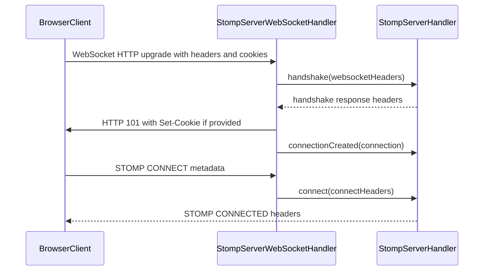
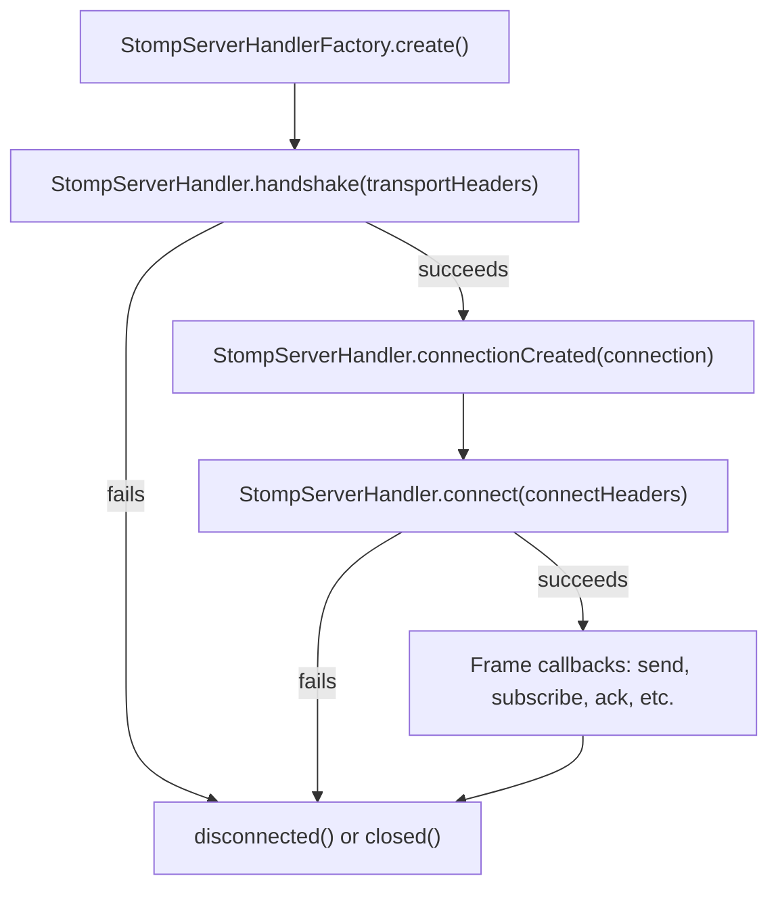

# vertx-stomp-lite
This is a simple implementation of a STOMP server that can be used with Vertx.
The method of extension is different than vertx-stomp. 

## Handshake Authentication Flow

`StompServerHandler` participates in the WebSocket HTTP handshake before the socket is accepted. Implementations can inspect the handshake headers, return HTTP response headers such as `Set-Cookie`, receive the `StompServerConnection` once it exists, and then handle the STOMP `CONNECT` frame.



## Handler Call Flow

The handler lifecycle separates transport setup, connection availability, and STOMP protocol connection.




## Client

`io.vertx.ext.stomp.lite.client` holds a STOMP 1.2 client over WebSocket that shares the frame
encoding and parsing of the server. It runs on the Vert.x context it is created on, exposes every
result as a Vert.x `Future`, negotiates heartbeats from the CONNECT and CONNECTED frames, and
reports the loss of a connection to the caller, who decides whether to reconnect.

```java
StompClient client = StompClient.create(vertx, new StompClientOptions());
WebSocketConnectOptions where = new WebSocketConnectOptions().setAbsoluteURI("ws://localhost:8080/stomp");

client.connect(where, Map.of(Frame.LOGIN, "alice", Frame.PASSCODE, "secret"))
      .onSuccess(connection -> {
          connection.closeHandler(cause -> log.info("connection closed", cause));
          connection.subscribe("sub-1", "/queue/greetings", Map.of(), frame -> log.info(frame.getBodyAsString()));
          // completes when the server's RECEIPT arrives, because the frame carries a receipt header
          connection.send("/queue/orders", Map.of(Frame.RECEIPT, "r-1"), Buffer.buffer("{}"));
      });
```

Headers the WebSocket upgrade request must carry go on the `WebSocketConnectOptions`; headers of the
CONNECT frame go in the map. The client adds `accept-version`, `heart-beat` and `host` itself. The
server's ERROR frames carry the `receipt-id` of the frame they answer, so a client waiting on that
receipt learns which of its frames failed.
